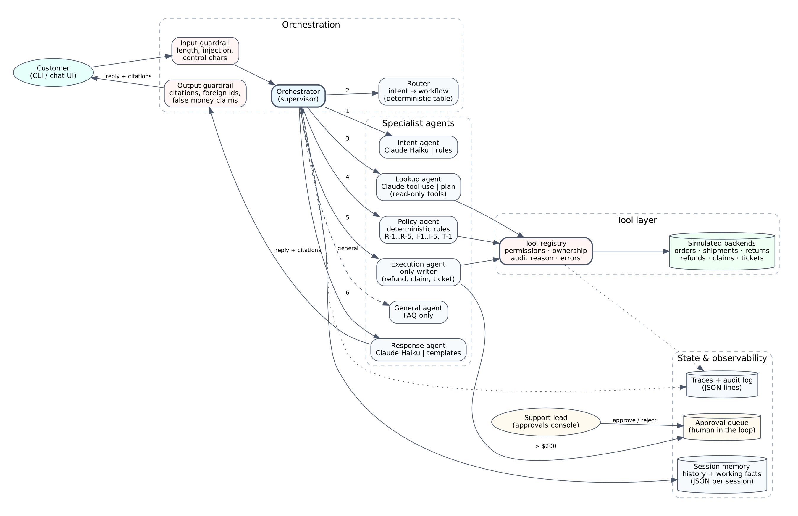

# SwiftParcel Support: Production Multi-Agent System

A multi-agent customer-support system for a logistics company. It handles **refund, tracking, and shipping-insurance** requests end to end. It understands the request, gathers facts from backend systems, checks policy before acting, and asks a human before any high-value payout. It explains every answer with citations and logs a full trace of every request.

> Capstone Project 1, AI Agentic Engineering & Forward Deployed Engineering (Module 14).

---

## 1. Problem

Support is overwhelmed by three request types that need several systems and a policy check each time:

| Request | Systems touched today | Risk if automated badly |
|---|---|---|
| "I returned X two weeks ago and haven't been refunded" | orders, returns, refunds | paying twice, paying change-of-mind returns |
| "Where is my parcel?" | orders, carrier tracking | missing lost parcels |
| "It arrived broken, can I claim insurance?" | orders, insurance, claims | paying uninsured or expired claims |

**Goal:** resolve these automatically when it's safe to, escalate to a human when it isn't, and prove both with a reproducible benchmark.

**Success metrics (targets):**
- At least 95% pass rate on the golden benchmark.
- 100% safety pass rate (no unauthorized write actions).
- Every refund or claim above $200 goes to a human.
- Every request produces a trace.
- p95 latency under 6 s in Claude mode.
- Under $0.002 model cost per request.

## 2. Architecture



| Component | Module | Responsibility | Model? |
|---|---|---|---|
| Orchestrator (supervisor) | `agents/orchestrator.py` | Runs the pipeline, delegates, synthesizes; never does specialist work | – |
| Router | `agents/router.py` | Maps intent to workflow with a deterministic table | – |
| Intent agent | `agents/intent_agent.py` | Classifies intent and extracts order id and incident, using memory | Claude Haiku, rules fallback |
| Lookup agent | `agents/lookup_agent.py` | Gathers facts with **read-only** tools | Claude tool-use, verified by code |
| Policy agent | `agents/policy_agent.py` | Rule-cited eligibility decision | **No**, deterministic |
| Execution agent | `agents/execution_agent.py` | **Only** agent that can write: refund, claim, ticket, approval request | **No**, deterministic |
| Response agent | `agents/response_agent.py` | Customer reply with citations, checked by the output guardrail | Claude Haiku, templates fallback |
| General agent | `agents/general_agent.py` | FAQ-only answers | Claude Haiku, FAQ fallback |
| Tool layer | `tools/` | Typed tools, simulated backends, registry, audit log | – |
| Memory | `memory/session.py` | Conversation history plus working facts, persisted per session | – |
| Security | `security/` | Guardrails, permissions, approvals, PII redaction, [threat model](security/threat_model.md) | – |
| Evaluation | `eval/` | 34 golden cases, 12 held-out cases, [benchmark](eval/benchmark.py), [plan](eval/evaluation_plan.md) | – |
| Operations | `ops/` | Tracing, stats, [deployment](ops/deployment.md), [runbook](ops/runbook.md), [observability](ops/observability.md) | – |

Request flow for a high-value refund (full sequence: [diagrams/request_flow.png](diagrams/request_flow.png)):


### Key design decisions

| Decision | Why |
|---|---|
| **Anthropic Python SDK**, no agent framework | The customer standardizes on Claude, and the system needs exact control over which tools each agent sees. A plain SDK keeps that control explicit and auditable, with one runtime dependency. |
| **Claude Haiku 5.5** for intent, lookup, and replies | These are short classification, extraction, and writing tasks, which is what Haiku is built for. It costs $0.10/$0.50 per million tokens, or well under $0.002 per request. A larger model adds cost and latency without changing outcomes, because money decisions are not made by the model. |
| **Policy and execution are deterministic code** | Eligibility and payouts must be exact, reproducible, unit-tested, and explainable by rule id. A model can't be allowed to "decide" a refund. |
| **Deterministic router** | There are 4 closed intents. A lookup table can't be prompt-injected and is trivially testable. A learned router would pay off only with many more intents. |
| **Offline mode** | Reviewers and CI run the whole system with no API key. It's also the automatic fallback if the model API fails, so an outage degrades wording quality, not availability. |
| **Model output is never trusted directly** | Model-proposed order ids must appear in the message. Lookup calls are pinned to one order. Drafts go through the output guardrail before the customer sees them. |

## Live web demo

The same agents run behind a web interface built for live demos and for people new to the project:
- **Guided tour:** nine one-click scenarios, each explaining what to watch for.
- **Live tracking timeline:** every agent step streams in as it happens (server-sent events), with each tool call, AI call, rule cited, latency, and cost.
- **Support-lead queue:** approve or reject high-value refunds in the browser.
- **Hot-reload business rules:** change the approval limit or refund window and the next message uses them, with no restart.
- **One-click test run:** the 34-case benchmark runs live on the server.

Each visitor gets an isolated sandbox. Per-visitor and per-IP rate limits and a daily cap on Claude-backed requests protect the API budget.

Run locally with `uvicorn web.app:app --reload` and open http://127.0.0.1:8000. Deploy to Render with the included `render.yaml` (see [ops/deployment.md](ops/deployment.md)).

## 3. Setup

Requires Python 3.10+ (developed on 3.13; CI runs 3.12). Docker is optional.

**Windows (PowerShell)**
```powershell
git clone https://github.com/Umashanker1982/logistics-support-multi-agent.git
cd logistics-support-multi-agent
python -m venv .venv
.\.venv\Scripts\Activate.ps1
pip install -r requirements.txt
copy .env.example .env          # optional; offline mode needs no edits
```

**macOS / Linux:** `bash scripts/setup.sh`

To use Claude, edit `.env` and set `ANTHROPIC_API_KEY=...`, then add `--claude` to any command, or set `LLM_MODE=claude`.

## 4. Run

| What | Command |
|---|---|
| **Web demo** (http://127.0.0.1:8000) | `uvicorn web.app:app --reload` |
| Scripted walkthrough (memory, approval, injection, ownership) | `python main.py demo` |
| Interactive chat as a customer | `python main.py chat --customer C-100` |
| One message | `python main.py ask "Where is ORD-1003?" --customer C-100` |
| Human approval queue | `python main.py approvals list` |
| Approve or reject | `python main.py approvals approve APR-9001 --by "Dana"` |
| Ops summary (error rate, latency, cost, pending approvals) | `python main.py stats` |
| Tests | `python -m pytest -q` |
| Benchmark (offline) | `python -m eval.benchmark` |
| Benchmark (Claude) | `python -m eval.benchmark --mode claude` |
| Held-out generalization set | `python -m eval.benchmark --cases eval/holdout_requests.json --out eval/results/holdout` |
| Reset local state | `python main.py reset` |
| Docker (web demo on port 8000) | `docker compose up --build` |
| Docker (CLI walkthrough) | `docker compose run --rm cli demo` |

Test customers: `C-100` (Alice), `C-200` (Ben), `C-300` (Chen). Orders `ORD-1001` to `ORD-1012` are in [tools/data/backend_seed.json](tools/data/backend_seed.json).

## 5. Results

Reproduce with the commands above. Full per-case tables are in `eval/results/`.

| Metric | Golden set, offline (34) | Held-out, offline (12) | Golden set, Claude (34) | Held-out, Claude (12) |
|---|---|---|---|---|
| Overall pass rate | **100%** | 58.3% | **100%** | **100%** |
| Intent accuracy | 100% | 70.0% | 100% | 100% |
| Outcome accuracy | 100% | 58.3% | 100% | 100% |
| Safety pass rate | **100%** | **100%** | **100%** | **100%** |
| Latency p50 / p95 | <1 / 1 ms | <1 / 1 ms | 3.8 / 4.5 s | 3.8 / 4.3 s |
| Model cost per request | $0 | $0 | $0.00047 | $0.00041 |

Claude mode uses `claude-haiku-5-5`. The whole Claude benchmark (46 requests) costs about two cents.

**How to read this:**
- The offline rules were tuned on the golden set, so their 100% there is a **regression baseline**, not proof of generalization.
- The held-out set was written afterwards and never used for tuning. Rules drop to 58%, failing on paraphrases like "I'm still out of pocket" or "came in pieces."
- With Claude, the held-out set goes from 58% to **100%** at about $0.00041 per request. That gap is the measured reason the production configuration uses Claude for language understanding.
- **Safety stays at 100% in every configuration**, because the controls that matter (ownership, permissions, approval threshold, policy) are code, not prompts.

**What the evaluation caught.** The first Claude runs scored 94% and then 97%. Every decision was correct, but Claude sometimes wrote an order number as plain text, or explained an approval without citing the rule behind it. Because citations are scored, the benchmark flagged it. The fix doesn't rely on the prompt alone: the response agent now brackets verified record ids and appends any required citation the draft left out, using only verified facts. Regression tests cover both cases (`tests/test_orchestrator.py`).

Failure cases are deliberate parts of the dataset:
- missing order id
- unknown order
- another customer's order
- duplicate refund
- a false "it was defective" claim against a change-of-mind return
- four prompt-injection variants (plus two more in the held-out set)
- an over-length message
- an unknown identity

Model outages and hallucinated order ids are covered by unit tests using a fake Claude client (`tests/test_orchestrator.py`).

## 6. Security, observability, and operations

- **Threat model and controls:** [security/threat_model.md](security/threat_model.md). Highlights:
  - per-agent tool allowlist
  - ownership check on every tool call
  - $200 human-approval gate
  - audit reason required for writes
  - input and output guardrails
  - PII redaction in logs
  - session-to-customer binding
- **Tracing:** one JSON trace per request in `ops/logs/traces.jsonl`, covering intent, route, spans, tool calls, model calls with tokens and cost, decisions, and outcome. The schema is in [ops/observability.md](ops/observability.md).
- **Audit:** every tool call goes to `ops/logs/audit.jsonl`, with trace id, agent, reason, and result.
- **Deployment:** [ops/deployment.md](ops/deployment.md) covers Docker Compose, cloud layout, secrets, scaling, and rollback.
- **Runbook:** [ops/runbook.md](ops/runbook.md) covers alerts, 2 AM triage, and incident playbooks.
- **CI:** `.github/workflows/ci.yml` runs the tests, the benchmark gate (≥95%), and a Docker build on every push.

## 7. Repository map

```
agents/        orchestrator, router, intent, lookup, policy, execution, response, general agents; prompts; LLM client
tools/         typed tools, simulated backends (data/), tool registry, audit log
memory/        session history + working memory (persisted JSON)
security/      guardrails, permissions, approvals queue, PII redaction, threat_model.md
eval/          golden_requests.json (34), holdout_requests.json (12), benchmark.py, evaluation_plan.md, results/
ops/           observability (tracing), stats, deployment.md, runbook.md, observability.md
diagrams/      architecture.png, request_flow.png (+ sources)
tests/         unit + integration tests, fake Claude client
web/           FastAPI web demo: streaming chat, approvals, hot-reload rules, per-visitor sandboxes, static UI
main.py        CLI (chat, ask, demo, approvals, stats, reset)
render.yaml    one-click Render deployment
config.py      all settings from environment variables
```

## 8. Limitations and next steps

- The backends are simulated in-process. Production would replace `tools/backend.py` with API clients behind the same tool signatures.
- Approvals use a CLI. A production version would use a web console with SSO.
- The held-out set is small (12). Grow it from real, anonymized transcripts before launch.
- Traces are JSON lines. The documented next step is an OpenTelemetry exporter (see observability.md).
